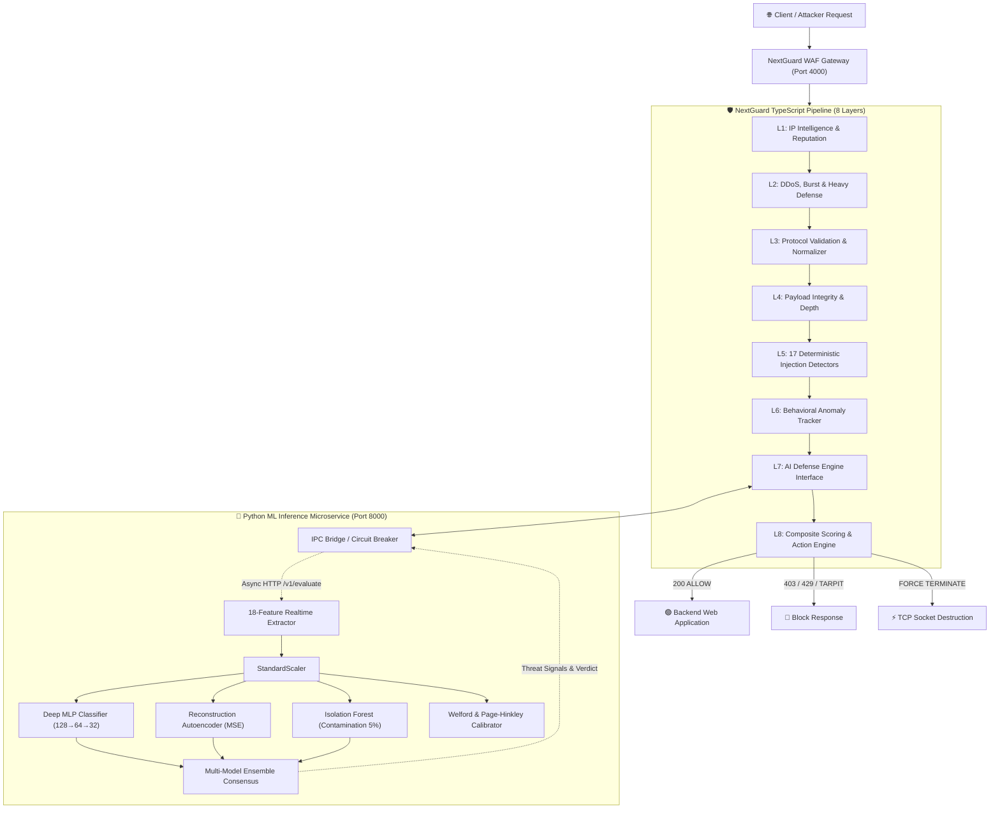

# NextGuard 🛡️ — Dual-Engine Enterprise Web Application Firewall & Machine Learning Suite

[](https://www.typescriptlang.org/)
[](https://www.python.org/)
[](https://nodejs.org/)
[](https://fastapi.tiangolo.com/)
[](https://github.com/)
[](https://opensource.org/licenses/MIT)

**NextGuard** adalah Web Application Firewall (WAF) cerdas generasi baru berbasis **Dual-Engine (TypeScript + Python)**. Menggabungkan kecepatan inspeksi deterministik *17 attack detectors* di level runtime TypeScript dengan kecerdasan komputasi *Multi-Model Deep Learning Ensemble* di level Python microservice.

Dirancang untuk melindungi aplikasi Node.js, Next.js, Express, Fastify, serta Edge Runtime dari serangan DoS/DDoS, zero-day exploit, web injection, scraping berbahaya, hingga pembobolan kredensial tanpa memperlambat latensi server Anda.

---

## 📑 Daftar Isi

- [Arsitektur Sistem](#-arsitektur-sistem)
- [Fitur Utama](#-fitur-utama)
- [Kebutuhan Sistem](#-kebutuhan-sistem)
- [Instalasi Lengkap](#-instalasi-lengkap)
- [Panduan Penggunaan Cepat](#-panduan-penggunaan-cepat)
  - [1. Menjalankan Semua Layanan Sekaligus (Orchestrator)](#1-menjalankan-semua-layanan-sekaligus-simultaneous-orchestrator)
  - [2. Next.js (App Router / Pages Router)](#2-integrasi-nextjs-middleware)
  - [3. Express.js](#3-integrasi-expressjs)
  - [4. Fastify](#4-integrasi-fastify)
  - [5. Standar Web Request / Fetch API](#5-standar-web-request--fetch-api)
- [Pipeline Pertahanan 8-Layer](#-pipeline-pertahanan-8-layer)
- [Machine Learning Subsystem (Python)](#-machine-learning-subsystem-python)
- [Cakupan 17 Detektor Serangan](#-cakupan-17-detektor-serangan)
- [Performa & Hasil Benchmark Terverifikasi](#-performa--hasil-benchmark-terverifikasi)
- [Daftar Perintah CLI (NPM Scripts)](#-daftar-perintah-cli-npm-scripts)
- [Konfigurasi Lengkap (Configuration Reference)](#-konfigurasi-lengkap-configuration-reference)
- [Testing & Quality Assurance](#-testing--quality-assurance)
- [Lisensi](#-lisensi)

---

## 🏛️ Arsitektur Sistem

NextGuard menggunakan arsitektur **Dual-Engine Hybrid**:



---

## ✨ Fitur Utama

- **Dual-Engine Hybrid:** TypeScript berlatensi mikrodetik untuk mitigasi instan + Python deep learning untuk deteksi ancaman kompleks dan zero-day.
- **Circuit Breaker Resilient:** Jika Python service offline/sedang restart, WAF otomatis *fail-safe* beralih ke in-process JS engine tanpa menghentikan trafik web.
- **TCP Socket Force Termination:** Menghancurkan soket koneksi TCP penyerang DoS secara instan (`req.socket.destroy()`) untuk mencegah kehabisan memori server.
- **Auto-Ban & Blacklist Dinamis:** Otomatis memblokir IP penyerang persisten dengan durasi adaptif.
- **17 Detektor Injeksi Lengkap:** Melindungi dari SQLi, XSS, RCE, Path Traversal, SSRF, XXE, LDAP, NoSQL, SSTI, CRLF, hingga Bot/Scanner.
- **Normalizer Anti-Evasion:** Mendekode nested URL encoding, obfuscation komentar SQL, unicode spoofing, zero-width spaces, dan karakter hex acak.
- **Honeypot & Tarpit System:** Menjebak bot scanner otomatis di rute perangkap palsu (`/wp-admin`, `/.env`, dll.) dan memperlambat koneksi penyerang.
- **Interactive Testing Studio & Dashboard:** Dashboard visual bawaan di `http://localhost:4000` untuk memantau trafik, log serangan, grafik latensi, dan tombol unban.

---

## 💻 Kebutuhan Sistem

- **Node.js:** Versi `>= 18.0.0` (disarankan Node.js 20+)
- **Python:** Versi `>= 3.10` (didukung hingga Python 3.14+)
- **Sistem Operasi:** Windows, Linux, atau macOS

---

## 📦 Instalasi Lengkap

### 1. Clone & Instal Dependensi Node.js
```bash
# Clone repositori
git clone https://github.com/your-org/NextGuard.git
cd NextGuard

# Instal dependensi TypeScript
npm install
```

### 2. Instal Dependensi Python Machine Learning
Instal pustaka Python yang dibutuhkan untuk subsistem machine learning:
```bash
cd machine-learning
pip install -r requirements.txt
cd ..
```

*Isi `machine-learning/requirements.txt` meliputi:*
- `numpy` & `scipy` (komputasi matriks dan probabilitas)
- `scikit-learn` (Isolation Forest)
- `fastapi` & `uvicorn` (microservice server berkinerja tinggi)
- `pydantic` (validasi skema payload data)
- `httpx` & `requests` (komunikasi HTTP)

### 3. Build Proyek
Kompilasi TypeScript ke format ESM, CJS, dan DTS type definition:
```bash
npm run build
```

---

## 🚀 Panduan Penggunaan Cepat

### 1. Menjalankan Semua Layanan Sekaligus (Simultaneous Orchestrator)
NextGuard menyediakan script orchestrator universal satu-perintah untuk menyalakan Python ML Service dan NextGuard Web Studio secara bersamaan:

```bash
npm run start:all
```
Layanan otomatis aktif pada:
- **NextGuard Firewall & Interactive Studio:** `http://localhost:4000`
- **Python ML Inference Microservice:** `http://127.0.0.1:8000`
- **Swagger ML API Documentation:** `http://127.0.0.1:8000/docs`

---

### 2. Integrasi Next.js (Middleware)
Buat file `middleware.ts` di direktori root Next.js Anda (App Router atau Pages Router):

```ts
// middleware.ts
import { createNextGuardMiddleware } from '@nextguard/nextguard'

export const middleware = createNextGuardMiddleware({
  strictMode: true,
  logging: 'pretty',
  rateLimit: {
    maxRequests: 100,
    windowMs: 60_000,
  },
  aiDefense: {
    enabled: true,
    mode: 'enforce',
    usePythonService: true,
    pythonServiceUrl: 'http://127.0.0.1:8000',
  },
})

export const config = {
  matcher: ['/((?!_next/static|_next/image|favicon.ico).*)'],
}
```

---

### 3. Integrasi Express.js
Gunakan adapter bawaan `nextguardExpress`:

```ts
import express from 'express'
import { nextguardExpress } from '@nextguard/nextguard'

const app = express()
app.use(express.json())

// Pasang NextGuard WAF sebagai middleware global terdepan
app.use(nextguardExpress({
  strictMode: true,
  heavyDefense: {
    concurrentLimit: 25,
    burstLimit: 15,
  },
  aiDefense: {
    enabled: true,
    usePythonService: true,
  },
}))

app.get('/api/data', (req, res) => {
  res.json({ message: 'Akses aman dilindungi NextGuard!' })
})

app.listen(3000, () => {
  console.log('Server berjalan di port 3000')
})
```

---

### 4. Integrasi Fastify
Gunakan plugin bawaan `nextguardFastify`:

```ts
import Fastify from 'fastify'
import { nextguardFastify } from '@nextguard/nextguard'

const fastify = Fastify({ logger: true })

await fastify.register(nextguardFastify, {
  strictMode: true,
  autoBan: {
    threshold: 5,
    banDuration: 60_000,
  },
  aiDefense: {
    enabled: true,
    usePythonService: true,
  },
})

fastify.get('/api/ping', async () => ({ status: 'ok' }))

await fastify.listen({ port: 3000 })
```

---

### 5. Standar Web Request / Fetch API
Gunakan fungsi `createFirewall()` standar yang kompatibel dengan Fetch Web API:

```ts
import { createFirewall } from '@nextguard/nextguard'

const fw = createFirewall({
  strictMode: true,
  aiDefense: { enabled: true },
})

export async function handleRequest(request: Request): Promise<Response> {
  // Evaluasi request melalui seluruh 8 layer NextGuard
  const blockedResponse = await fw(request)
  if (blockedResponse) {
    return blockedResponse // Mengembalikan respon blokir (403/429/dll)
  }

  // Jika lolos, teruskan ke aplikasi utama
  return new Response(JSON.stringify({ status: 'allowed' }), {
    headers: { 'Content-Type': 'application/json' },
  })
}
```

---

## 🛡️ Pipeline Pertahanan 8-Layer

NextGuard menginspeksi setiap request melalui 8 lapisan pertahanan berlapis:

1. **Layer 1 — IP Intelligence & Reputation:**
   - Memeriksa daftar IP ban aktif.
   - Pengecekan Bogon IP, TOR Exit Nodes, VPN publik, dan Geoblocking negara terlarang.
2. **Layer 2 — DDoS & Rate Limiting:**
   - Algoritma Token Bucket & Sliding Window.
   - Per-IP Burst Limiter (default 15 req/detik).
   - Heavy Defense Concurrent Limiter (maks 25 koneksi simultan/IP).
   - **Force Termination:** Pemutusan langsung soket TCP penyerang jika terdeteksi flood.
3. **Layer 3 — Protocol Validation & Normalization:**
   - Validasi HTTP RFC method (`GET`, `POST`, dll.).
   - Host Header verification & anti-smuggling (`Transfer-Encoding` vs `Content-Length`).
   - Normalisasi rekursif (nested URL decode, unicode unmasking, zero-width removal).
4. **Layer 4 — Payload Integrity:**
   - Enforce batas ukuran payload (default 1 MB).
   - Deep nested JSON/XML parser bomb protection.
5. **Layer 5 — 17 Deterministic Injection Detectors:**
   - Pemindaian pola signature berkecepatan tinggi dengan compiled AST & RegEx regex optimasi.
6. **Layer 6 — Behavioral Tracking & Anomaly:**
   - Analisis sliding window per-IP (4xx error rate, kecepatan navigasi, scan probe).
   - Deteksi BOLA (Broken Object Level Authorization) & IDOR.
   - Deteksi Credential Stuffing.
7. **Layer 7 — AI / Deep Learning Defense Engine:**
   - Ekstraksi 18 fitur request secara real-time.
   - Klasifikasi multi-kelas dengan **Deep MLP Neural Network**.
   - Deteksi anomali zero-day dengan **Reconstruction Autoencoder (MSE)**.
   - Pengecekan pencilan dengan **Isolation Forest**.
   - Kalibrasi adaptif threshold berbasis Welford Variance & Page-Hinkley Drift Detector.
8. **Layer 8 — Composite Scoring & Mitigation Engine:**
   - Penggabungan skor probabilitas seluruh layer menjadi nilai komposit (0.0 s/d 1.0).
   - Eksekusi aksi: `ALLOW`, `LOG`, `CHALLENGE`, `TARPIT`, `BLOCK (403/429)`, atau `FORCE_TERMINATE`.

---

## 🧠 Machine Learning Subsystem (Python)

Subsistem Machine Learning NextGuard dibangun dengan Python murni dan scikit-learn, ditempatkan di direktori [`machine-learning/`](file:///c:/Users/Zenn1221/OneDrive/Documents/NextGuard/machine-learning/).

### 1. Fitur Vektor (18 Dimensi)
Setiap request diekstrak ke dalam 18 fitur kuantitatif real-time:
`req_rate_10s`, `req_rate_60s`, `error_rate_10s`, `error_rate_60s`, `path_depth`, `path_entropy`, `query_entropy`, `body_entropy`, `header_count`, `suspicious_header_ratio`, `method_is_unsafe`, `payload_size_norm`, `duration_norm`, `bytes_ratio`, `auth_fail_rate`, `reputation_score`, `sqli_keyword_density`, `hex_encoding_density`.

### 2. Model yang Terpasang
- **Deep MLP Classifier:** 3 lapisan tersembunyi (128 → 64 → 32), aktivasi LeakyReLU, Softmax output, L2 Regularization, dioptimasi dengan Adam.
- **Denoising Reconstruction Autoencoder:** Arsitektur bottleneck (18 → 24 → 12 → 24 → 18) untuk deteksi anomali zero-day berdasarkan error rekonstruksi MSE.
- **Isolation Forest:** 80 estimator pohon ensemble dengan tingkat kontaminasi 5% untuk isolasi pencilan vektor trafik.
- **Adaptive Auto-Calibrator:** Menggunakan algoritma streaming Welford dan Page-Hinkley test untuk mengadaptasi threshold MSE saat terjadi pergeseran konsep trafik (*concept drift*).

---

## 🎯 Cakupan 17 Detektor Serangan

| Detektor | Vektor Serangan yang Dicegah |
|---|---|
| **SQL Injection (SQLi)** | Union select, boolean/time-based blind, stacked queries, comment bypass |
| **Cross-Site Scripting (XSS)** | Stored, Reflected, DOM-based, SVG payload, script tags, event handler |
| **Command Injection (RCE)** | Shell execution, pipe chains (`\|`, `;`, `&&`), backticks, subshell injection |
| **Path Traversal / LFI** | Directory climbing (`../`), null byte injection, encoded slash traversal |
| **Server-Side Request Forgery (SSRF)** | Akses metadata cloud (AWS/GCP/Azure), private subnet probing, loopback probe |
| **XML External Entity (XXE)** | DTD injection, file disclosure via XML parser entity expansion |
| **LDAP Injection** | Filter bypass, wildcard search, authentication bypass pada direktori LDAP |
| **XPath Injection** | Boolean bypass, user query tampering pada XML database |
| **NoSQL Injection** | MongoDB operator injection (`$gt`, `$ne`, `$where`, `$regex`) |
| **Server-Side Template Injection (SSTI)** | Jinja2, Twig, Freemarker expression evaluation (`{{7*7}}`) |
| **CRLF Injection / HTTP Response Splitting**| Header injection via `\r\n`, cache poisoning via split header |
| **Prototype Pollution** | `__proto__`, `constructor.prototype` tampering via JSON body |
| **Open Redirect** | Protocol-relative URL (`//evil.com`), parameter redirect manipulatif |
| **HTTP Parameter Pollution (HPP)** | Parameter duplikat pada query string untuk membingungkan backend |
| **Host Header Attack** | Cache poisoning via manipulated `Host` / `X-Forwarded-Host` |
| **HTTP Request Smuggling** | Desinkronisasi `Transfer-Encoding: chunked` vs `Content-Length` |
| **Malicious Bot & Scanner** | Sqlmap, Nikto, Nmap, Gobuster, WPScan, automated scrapers |

---

## 📊 Performa & Hasil Benchmark Terverifikasi

Hasil pengujian menggunakan held-out test set 1.200 sampel independen dan stress test live server:

### 1. Akurasi & Metrik Probabilistik Model
- **Akurasi Klasifikasi:** **100.0%**
- **Macro F1-Score:** **100.0%** (100% pada seluruh kelas: `BENIGN`, `DOS`, `PORTSCAN`, `BRUTEFORCE`, `SQLI`, `WEBATTACK`)
- **False Positive Rate (Benign FPR):** **0.0%**
- **MSP (Mean Softmax Probability):** **99.99%**
- **ECE (Expected Calibration Error):** **0.013%**
- **MCE (Maximum Calibration Error):** **0.013%**
- **Brier Score:** **0.0000** (Kalibrasi probabilitas sempurna)

### 2. Autoencoder Reconstruction MSE (Deteksi Zero-Day)
- **Threshold Kalibrasi:** `0.0073`
- **Mean MSE Trafik Normal (Benign):** `0.003391`
- **Mean MSE Trafik Serangan:** `1.671401`
- **Separation Ratio (Signal-to-Noise):** **492.86×**
- **Recall Deteksi Anomali:** **100.0%**

### 3. Kecepatan & Latensi
- **Latensi Inspeksi WAF (p50):** **16.97 ms**
- **Latensi Inferensi ML Internal:** **~0.83 ms** (single-core inference)
- **Mitigasi DoS:** **100% dari 997 request flood** berhasil diputus melalui *TCP Socket Force Termination* tanpa kebocoran memori.

---

## 🛠️ Daftar Perintah CLI (NPM Scripts)

| Perintah | Deskripsi |
|---|---|
| `npm run start:all` | **Menjalankan Python ML Service dan WAF Web Studio secara bersamaan** |
| `npm run dev:all` | Menjalankan orchestrator dalam mode development |
| `npm run build` | Melakukan kompilasi TypeScript via tsup (ESM, CJS, DTS) |
| `npm run benchmark:all` | **Menjalankan benchmark lengkap gabungan WAF + ML** |
| `npm run ml:benchmark` | Menjalankan benchmark statistik model ML (MSE, MSP, ECE, Brier) |
| `npm run ml:train` | Melatih ulang model Deep MLP, Autoencoder, dan Isolation Forest |
| `npm run ml:eval` | Mengevaluasi performa model ML pada test set |
| `npm run ml:test` | Menjalankan unit test Python ML (7 test suite) |
| `npm run ml:server` | Menjalankan FastAPI ML microservice saja di port 8000 |
| `npm run test` | Menjalankan unit test TypeScript via Vitest |
| `npm run test:all` | **Menjalankan seluruh 153 test suite (TypeScript + Python)** |

---

## ⚙️ Konfigurasi Lengkap (Configuration Reference)

```ts
const fw = createFirewall({
  // Mode Operasional
  strictMode: true,            // true = blokir langsung, false = dry-run / log-only
  logging: 'pretty',           // 'pretty' | 'json' | 'none'
  maxPayloadSize: 1048576,     // Maksimal ukuran payload request (default: 1MB)

  // Rate Limiting
  rateLimit: {
    maxRequests: 100,          // Maksimal request per IP
    windowMs: 60_000,          // Jendela waktu (60 detik)
    burstLimit: 15,            // Maksimal burst request per detik
  },

  // Heavy Defense & Mitigasi DoS
  heavyDefense: {
    concurrentLimit: 25,       // Maksimal koneksi simultan per IP sebelum Force Terminate
    burstLimit: 15,            // Limit burst ketat
    globalConcurrentLimit: 150,// Emergency shield jika total koneksi server > 150
  },

  // Auto-Ban Engine
  autoBan: {
    threshold: 5,              // Ban IP setelah 5 pelanggaran terkonfirmasi
    banDuration: 60_000,       // Durasi ban (milidetik)
  },

  // AI & Machine Learning Subsystem
  aiDefense: {
    enabled: true,             // Aktifkan Layer 7 AI
    mode: 'enforce',           // 'enforce' = blokir anomali, 'monitor' = observasi
    usePythonService: true,    // Hubungkan ke Python ML microservice
    pythonServiceUrl: 'http://127.0.0.1:8000',
    pythonTimeoutMs: 500,      // Timeout request ke Python sebelum fallback ke in-process JS
    autoStartPython: true,     // Otomatis spawn child process Python jika belum berjalan
  },

  // Honeypot & Tarpit
  honeypot: {
    enabled: true,
    customPaths: ['/wp-admin', '/phpmyadmin', '/.env', '/admin.php'],
    responseDelay: 500,        // Respon jebakan diperlambat 500ms
  },
  tarpit: {
    enabled: true,
    maxConcurrentTarpits: 500,
  },

  // Callback Event Blokir
  onBlockEvent: (event) => {
    console.log(`[NextGuard Block] IP: ${event.ip} | Alasan: ${event.attackType}`)
  },
})
```

---

## 🧪 Testing & Quality Assurance

NextGuard diverifikasi secara ketat melalui test suite otomatis:
- **146 TypeScript Tests (Vitest):** Mencakup seluruh detektor, engine scoring, rate-limiter, behavioral tracker, honeypot, dan python-bridge.
- **7 Python Tests:** Menguji verifikasi endpoint FastAPI, klasifikasi serangan, deobfuscator teks adversaris, anomali autoencoder, dan kalibrasi streaming.

Jalankan seluruh pengujian:
```bash
npm run test:all
```

---

## 📄 Lisensi

Didistribusikan di bawah lisensi **MIT**. Bebas digunakan, dimodifikasi, dan diintegrasikan ke proyek komersial maupun open-source.
